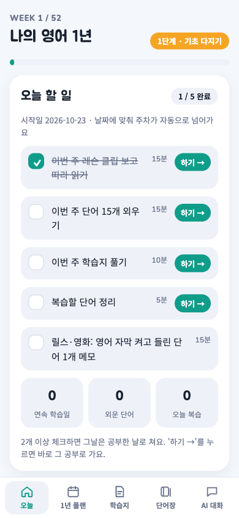
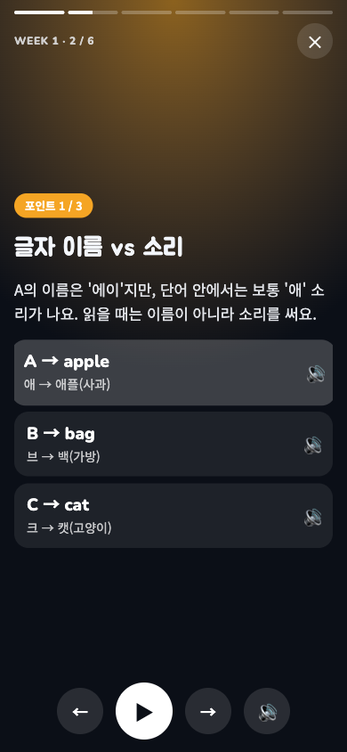
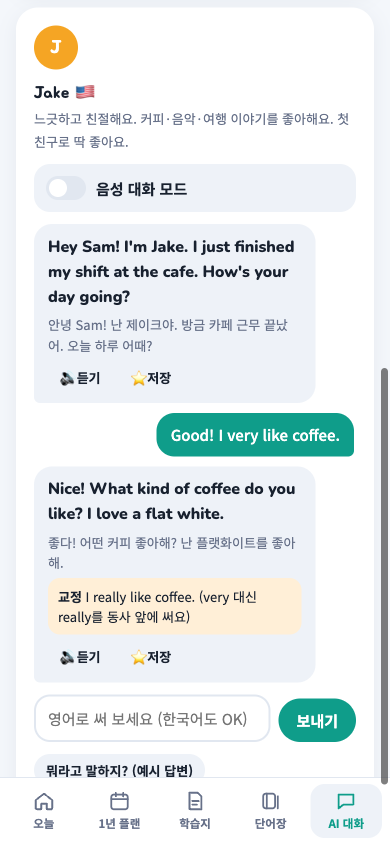

# 나의 영어 1년 (English Year)

[](../../actions/workflows/ci.yml)

철자도 읽기 어려운 **완전 초보 성인**이 1년 동안 **여행 회화 → 친구 사귀기 → 비즈니스 영어**까지 가도록 설계한 52주 영어 과정입니다.
아이폰 홈 화면에 설치해서 쓰는 웹앱(PWA)이고, 사람 대신 **AI 대화 친구**와 말로 연습합니다.

> A 52-week English course for Korean adult beginners, built as an installable iPhone web app.
> Lessons, flashcards and worksheets work offline; conversation practice uses the Claude API with the learner's own key.

<p align="center">
  
  
  
</p>
<p align="center"><sub>화면의 AI 답은 예시입니다.</sub></p>

## 기능

| 영역               | 내용                                                                                                                                          |
| ------------------ | --------------------------------------------------------------------------------------------------------------------------------------------- |
| **1년 플랜**       | 4단계(기초 다지기 → 입 트기 → 실전 대화 → 비즈니스 입문) 52주. 시작일 기준으로 이번 주가 자동 계산되고, 단계마다 하루 할 일 5개가 바뀝니다.   |
| **레슨 클립**      | 주마다 6장짜리 스토리형 슬라이드. 기기 음성으로 한국어 설명과 영어 예문을 읽어 주고, 마지막에 따라 말하기 연습이 있습니다. 52주 × 3개 포인트. |
| **단어장**         | 주차별 단어 780개, 실생활 슬랭 82개, 직접 추가한 단어. 간격 반복(1 → 3 → 7 → 14 → 30일)으로 복습 날짜를 잡습니다.                             |
| **학습지**         | 주차별 8문제(뜻·영작·듣기·어순), 단계 정리, 단계 테스트 20문제, 받아쓰기, 따라 말하기 발음 채점, AI가 만드는 추가 학습지.                     |
| **AI 친구**        | 사는 곳·직업·성격이 다른 친구 5명. 대화를 요약해 기억하고, 답마다 한국어 해석과 문장 교정을 붙입니다.                                         |
| **상황 연습**      | 카페·공항·호텔·길 묻기·회의 등 8개 롤플레이. 미션이 있고 끝나면 점수와 고칠 문장을 알려 줍니다.                                               |
| **음성 대화 모드** | 말하면 자동으로 보내고, AI 답을 읽어 준 뒤 다시 듣습니다. 손을 쓰지 않고 대화할 수 있습니다.                                                  |
| **쓰기 첨삭**      | 자기소개·이메일 등 11가지 과제를 고쳐 주고 이유를 설명합니다.                                                                                 |
| **오프라인·백업**  | AI 기능 외에는 인터넷 없이 동작합니다. 학습 기록은 JSON 파일로 백업·복원합니다.                                                               |

## 시작하기

Node.js 22.12 이상이 필요합니다.

```bash
npm install
npm run dev        # http://localhost:5173
```

| 명령               | 하는 일                                                     |
| ------------------ | ----------------------------------------------------------- |
| `npm run dev`      | 개발 서버                                                   |
| `npm run build`    | `dist/`에 배포용 빌드 (CSP·서비스 워커 생성 포함)           |
| `npm run preview`  | 빌드 결과를 로컬에서 확인                                   |
| `npm test`         | 단위·화면 테스트 (Vitest + jsdom)                           |
| `npm run test:e2e` | 실제 브라우저 기능 테스트 (Playwright, AI·음성은 가짜 응답) |
| `npm run ci`       | 타입 검사 → 린트 → 포맷 검사 → 테스트 → 빌드 (CI와 동일)    |

### 아이폰에 설치

1. `main`에 올리면 [`deploy.yml`](.github/workflows/deploy.yml)이 검사 후 GitHub Pages에 자동 배포합니다. 배포 주소: https://penkim95-cmd.github.io/english-year/
2. 아이폰 Safari로 주소를 열고 **공유 → 홈 화면에 추가**를 누릅니다.
3. 한 번 설치하면 재설치 없이 새 버전이 자동으로 반영됩니다(서비스 워커).

### AI 기능 켜기

[Anthropic Console](https://console.anthropic.com)에서 API 키를 만들고, 앱의 **오늘 → 설정**에 넣습니다.
키는 그 기기에만 저장되고 `api.anthropic.com` 말고는 어디로도 보내지 않습니다. 이 앱 전용 키를 만들고 월 사용 한도를 걸어 두기를 권합니다. 자세한 내용은 [SECURITY.md](SECURITY.md)에 있습니다.

## 구조

```
src/
├─ main.ts            진입점: 화면·동작·플랫폼 서비스 연결
├─ types.ts           공용 타입
├─ core/              날짜, 시드 난수, 안전한 저장소 (브라우저 API 외 의존 없음)
├─ data/              과정 콘텐츠(JSON)와 단계·친구·상황 정의
├─ domain/            순수 학습 로직: 간격 반복, 학습지 생성, 받아쓰기 채점, 진도
├─ state/             기기 저장 상태와 백업
├─ ai/                Claude API 클라이언트, 프롬프트, 응답 파싱, 오류
├─ speech/            음성 합성(TTS)·음성 인식(한 번에 하나만)
├─ ui/                렌더러, 앱 셸, 화면(views), 레슨 클립 플레이어
└─ styles/            디자인 토큰과 컴포넌트 스타일
build/pwa.ts          빌드 시 CSP 삽입·서비스 워커 생성
tests/                도메인·저장소·화면 테스트
docs/                 아키텍처, 학습 설계, 설계 결정 기록(ADR)
```

의존 방향은 `ui → state·ai·speech → domain → core·data` 한쪽으로만 흐릅니다. 자세한 설명은 [docs/ARCHITECTURE.md](docs/ARCHITECTURE.md)에 있습니다.

## 문서

- [아키텍처](docs/ARCHITECTURE.md): 계층, 렌더링·동작 흐름, 저장, AI·음성, 빌드
- [학습 설계](docs/LEARNING_DESIGN.md): 왜 이 순서와 이 분량인지
- [설계 결정 기록](docs/adr/): 프레임워크 없이 만든 이유, 브라우저에서 Claude API를 직접 부르는 이유 등
- [보안](SECURITY.md) · [기여 안내](CONTRIBUTING.md) · [변경 기록](CHANGELOG.md)

## 라이선스

코드는 [MIT](LICENSE). 글꼴은 Google Fonts(OFL), Anthropic SDK는 Apache-2.0입니다.
