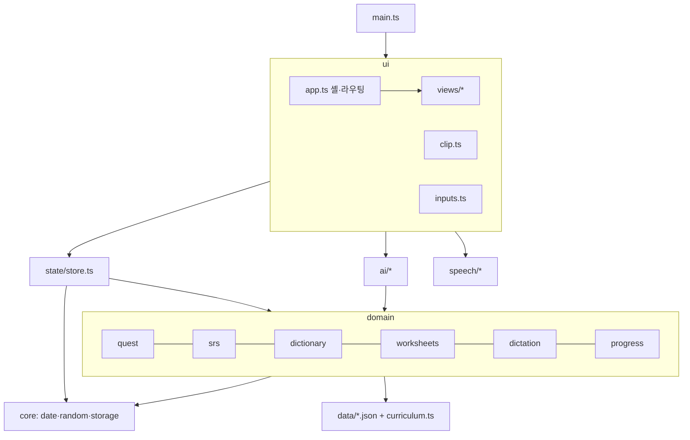
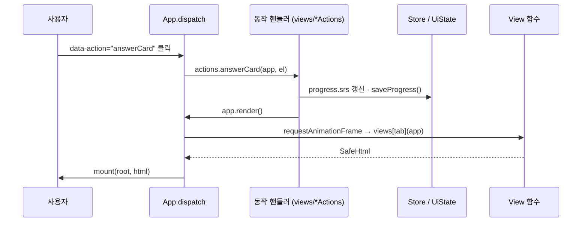

# 아키텍처

이 문서는 코드가 어떻게 나뉘어 있고, 데이터와 사용자 입력이 어떤 길로 흐르는지 설명합니다.
왜 이렇게 정했는지는 [설계 결정 기록(ADR)](adr/)에 따로 적었습니다.

## 1. 목표와 제약

| 제약                                      | 설계에 미친 영향                                                                                        |
| ----------------------------------------- | ------------------------------------------------------------------------------------------------------- |
| 휴대폰 한 대로 1년 동안 매일 쓴다         | 설치형 PWA, 오프라인 우선, 기록은 기기에 저장 ([ADR 0003](adr/0003-pwa-instead-of-app-store.md))        |
| 서버를 운영하지 않는다                    | 학습자 본인의 API 키로 기기에서 Claude API를 직접 호출 ([ADR 0002](adr/0002-client-side-claude-api.md)) |
| 화면 5개, 상태가 단순하다                 | 프레임워크 없이 TypeScript + 작은 렌더러 ([ADR 0001](adr/0001-vanilla-typescript-no-framework.md))      |
| 콘텐츠(52주 레슨·780단어)가 코드보다 크다 | 콘텐츠는 JSON, 코드는 타입으로 형식을 보장 ([ADR 0004](adr/0004-content-as-json.md))                    |
| 마이크·스피커는 하나다                    | 음성 인식·재생 상태를 한 모듈에서만 관리 ([ADR 0005](adr/0005-single-speech-session.md))                |

## 2. 계층

- **core**: 날짜 계산, 시드 난수(mulberry32), 예외를 던지지 않는 `localStorage` 래퍼와 `sanitizeJson`. 다른 모듈을 import하지 않습니다.
- **data**: `lessons.json`, `vocab.json`, `slang.json`, `weeks.json`, `stage-sheets.json`과, 코드로 표현하는 편이 나은 정의(4단계·AI 친구 5명·상황 8개·쓰기 과제 11개)를 담은 `curriculum.ts`.
- **domain**: DOM을 모르는 순수 함수. 같은 입력이면 항상 같은 결과라서 단위 테스트가 쉽습니다.
- **state**: 기기에 저장되는 두 문서(진도·개인 기록)를 읽고, 검증하고, 저장하고, 백업합니다.
- **ai / speech**: 외부 세계(Claude API, Web Speech API)와 맞닿는 경계. 실패를 앱의 언어로 바꿔 돌려줍니다.
- **ui**: 화면을 그리고 사용자 동작을 상태 변경으로 바꿉니다.

의존은 위에서 아래로만 흐릅니다. `domain`은 `ui`를, `core`는 아무것도 모릅니다.

## 3. 렌더링과 동작 흐름

- **화면 = 상태의 함수.** 각 화면은 `(app) => SafeHtml` 하나입니다. 부분 갱신 대신 탭 전체를 다시 그리고, `render()`는 한 프레임에 한 번만 그리도록 묶습니다.
- **이벤트 위임.** 클릭은 루트 요소 하나에서 받습니다. 버튼은 `data-action="이름"`과 인자(`data-week` 등)를 선언하고, 각 화면 모듈이 `xxxActions` 객체로 핸들러를 등록합니다(`main.ts`에서 합침). 입력·Enter·파일 선택은 `ui/inputs.ts`가 같은 방식으로 처리합니다.
- **자동 이스케이프.** 모든 마크업은 `html` 태그 템플릿(`ui/html.ts`)으로 만듭니다. 끼워 넣는 값은 기본으로 이스케이프되고, 이스케이프를 건너뛰는 `raw()`는 개발자가 쓴 고정 문자열에만 씁니다. ESLint 규칙이 `innerHTML` 직접 대입을 `html.ts` 밖에서 막습니다.
- **스트리밍 출력.** AI 답이 오는 동안에는 전체를 다시 그리지 않고 `#live`, `#writing-output` 요소의 `textContent`만 바꿉니다.
- **레슨 클립**은 탭과 별개인 전체 화면 오버레이라서 자체 렌더링과 클릭 처리를 가진 `ClipPlayer` 클래스로 분리했습니다. 내레이션은 단계 큐로 실행하고, 이동할 때마다 `token`을 올려 이전 큐를 조용히 취소합니다.

## 4. 상태와 저장

| 종류        | 위치                 | 키                                  | 내용                                                                                       |
| ----------- | -------------------- | ----------------------------------- | ------------------------------------------------------------------------------------------ |
| 진도        | `Store.progress`     | `eng-year-v1`                       | 시작일, 날짜별 할 일 체크, 점수, 클립 완료, 간격 반복 기록, 날짜별 학습 활동 수(최근 60일) |
| 개인 기록   | `Store.personal`     | `eng-year-v1-aux`                   | AI 친구 대화·기억 메모, 내 단어, 첨삭·평가 기록, 음성 설정, 프로필                         |
| 화면 상태   | `App.ui` (`UiState`) | 저장 안 함                          | 현재 탭, 입력 중인 글, 진행 중인 요청                                                      |
| 마지막 탭   | —                    | `eng-year-v1-tab`                   | 다시 열면 같은 탭                                                                          |
| API 키·모델 | —                    | `eng-year-apikey`, `eng-year-model` | 백업에 넣지 않음                                                                           |

- 저장 키는 첫 버전과 같아서 이전 앱에서 쓰던 기록을 그대로 읽습니다.
- 읽을 때는 `normalizeProgress` / `normalizePersonal`이 알려진 필드만, 맞는 타입만 받아들입니다. 백업 복원도 같은 함수를 거칩니다.
- 개인 기록은 대화 때문에 커질 수 있어서 300ms 단위로 묶어 저장하고, 앱이 백그라운드로 가거나(`visibilitychange`) 닫힐 때(`pagehide`) 바로 씁니다.
- 단어 카드는 출처별 키로 하나의 사전(`Dictionary`)에 모읍니다: `v:` 주차 단어, `s:` 슬랭, `x:` 직접 추가. 간격 반복 기록은 이 키로 저장합니다.

## 4-1. 오늘의 퀘스트

- `domain/quest.ts`의 `buildQuest()`가 단계의 하루 할 일 5개를 순서 있는 단계로 바꿉니다. 단계마다 목표(클립 1편, 카드 15장, 문제 8개, 받아쓰기 10문장, 메시지 6번 등)가 있고, 진행도는 그날 실제로 한 일의 수(`progress.activity[날짜]`)로 계산합니다. 첫 번째 미완료 단계만 '진행 중'이고 뒤 단계는 잠깁니다.
- 학습 기능은 끝난 일을 `App.track(종류)`로 알립니다(클립 '다 봤어요', 카드 넘김, 학습지 답, 받아쓰기 확인, 따라 말하기 녹음, AI 대화 전송, 첨삭). `track`은 퀘스트를 전후로 계산해 새로 끝난 단계가 있으면 하단 퀘스트 바에 '○단계 완료 · 다음 단계로'를 띄우고, 날짜별 체크(`progress.daily`)를 맞춰 연속 학습일이 그대로 이어지게 합니다.
- 앱 밖 활동(릴스 메모)은 '했어요' 버튼으로, 복습 단계는 오늘 복습할 카드가 없으면 자동 통과합니다.

## 5. AI

- `ai/client.ts`의 `complete(input, { tier, onText, signal })` 하나로 모든 호출을 합니다. SDK는 처음 AI 기능을 쓸 때 동적 import로 불러와서 첫 화면이 가볍습니다.
- `tier: "quick"`(대화 한 턴)은 짧은 출력·낮은 effort, 기본값(평가·첨삭·생성)은 긴 출력·중간 effort를 씁니다. Claude Opus 5에서는 서버 측 폴백(beta)을 켭니다.
- 프롬프트는 `ai/prompts.ts`에 모았고, 학습자 정보는 기기에 저장된 프로필에서만 가져옵니다(코드에 개인정보 없음).
- 대화 답은 `영어 / 해석: / 교정:` 형식으로 받아 `parseReply`가 나눕니다. JSON이 필요한 기능은 `completeJson`이 코드 블록·앞뒤 설명이 섞인 응답에서도 값을 꺼내고 `sanitizeJson`으로 정리합니다.
- AI 친구는 대화가 8번 쌓일 때마다 짧은 기억 메모를 새로 쓰고, 요청에는 최근 20턴과 메모만 보냅니다. 비용과 문맥 길이가 대화 길이에 비례해 늘지 않습니다.
- 실패는 `AiError` 코드(`no_key`, `auth`, `rate_limited`, `network` …)로 통일하고 화면에는 한국어 안내 한 줄만 보여 줍니다.

## 6. 음성

- **합성(TTS)**: 기기 내장 음성. 영어 음성 중 'Natural·Premium·Enhanced'를 우선 고르고 설정에서 바꿀 수 있습니다. 레슨 클립용 `say()`는 기기가 `end` 이벤트를 안 보내도 타이머로 다음 단계로 넘어갑니다.
- **인식**: Web Speech API(아이폰은 Apple 인식기). 한 번에 하나만 실행하고, 탭을 옮기거나 앱이 백그라운드로 가면 항상 멈춥니다.
- **음성 대화 모드**: 인식 결과 전송 → AI 답 읽기 → 읽기가 끝나면 350ms 뒤 다시 듣기. 자동 재시작이 사용자 제스처가 없어 거부되어도 마이크를 '사용 불가'로 표시하지 않습니다. 인식이 안 되는 환경을 위해 키보드 받아쓰기 입력이 2초 동안 바뀌지 않으면 자동 전송합니다.

## 7. 빌드와 배포

- Vite가 `index.html`과 `src/main.ts`에서 번들을 만들고, 콘텐츠 JSON은 번들에 포함됩니다. SDK는 별도 청크입니다.
- `build/pwa.ts` 플러그인이 빌드 때만
  - `index.html`에 Content-Security-Policy를 넣습니다(`script-src 'self'`, `connect-src 'self' https://api.anthropic.com`). 개발 서버는 인라인 스크립트가 필요해서 넣지 않습니다.
  - 내보낸 파일 전체 목록과 내용 해시로 `sw.js`를 만듭니다. 배포할 때마다 캐시 이름이 바뀌어 설치된 앱이 한 번에 새 버전으로 바뀌고, 입력 중이거나 클립을 보는 중이 아니면 자동으로 새로고침합니다(처음 설치할 때는 새로고침하지 않음).
- `base: "./"`라서 같은 빌드가 도메인 루트와 GitHub Pages 하위 경로 모두에서 동작합니다.

## 8. 테스트 전략

| 층            | 도구           | 무엇을 확인하나                                                                                                                                                           |
| ------------- | -------------- | ------------------------------------------------------------------------------------------------------------------------------------------------------------------------- |
| domain·core   | Vitest         | 간격 반복 일정, 52주 전체 학습지가 풀 수 있는지, 받아쓰기 채점, 날짜 경계                                                                                                 |
| state         | Vitest + jsdom | 기존 저장 키 읽기, 잘못된 데이터 거르기, 백업 왕복(키 제외), 위조 백업 거부                                                                                               |
| content       | Vitest         | 52주 모두 레슨 3포인트·단어 15개, 단계 연속성, ID 중복 없음                                                                                                               |
| ui            | Vitest + jsdom | 탭 전환, 할 일 체크, 학습지·카드 동작, 사용자 입력 이스케이프, 키 없을 때 안내                                                                                            |
| 실제 브라우저 | Playwright     | 배포 빌드에서 19개 사용 흐름(오늘의 퀘스트 단계 진행·첫 설치 시 새로고침 없음·설정·클립·학습지·단어장·AI 대화·음성 모드·백업·CSP). Claude API와 기기 음성은 `e2e/fixtures.ts`의 가짜 응답으로 대체 |

CI(`.github/workflows/ci.yml`)는 `npm run ci`를 실행한 뒤 E2E 테스트(`npm run test:e2e`)를 돌립니다.
